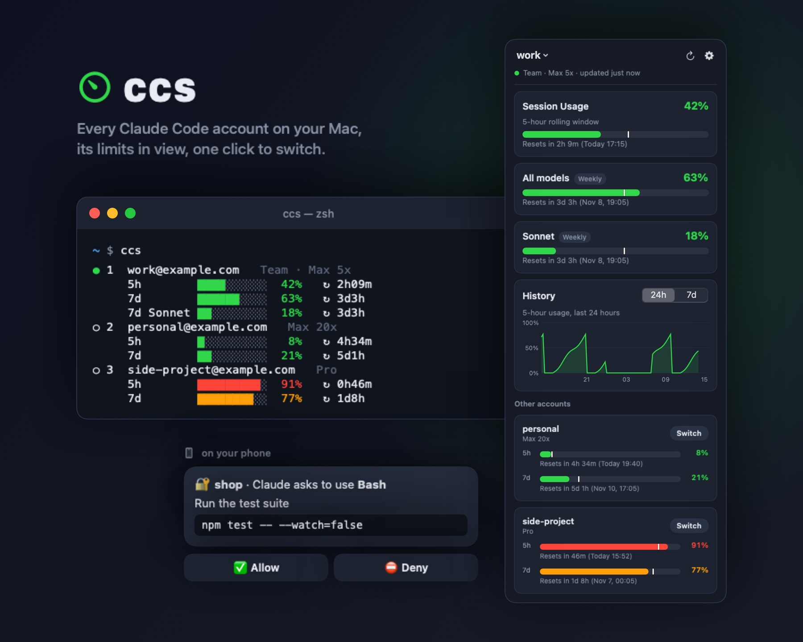
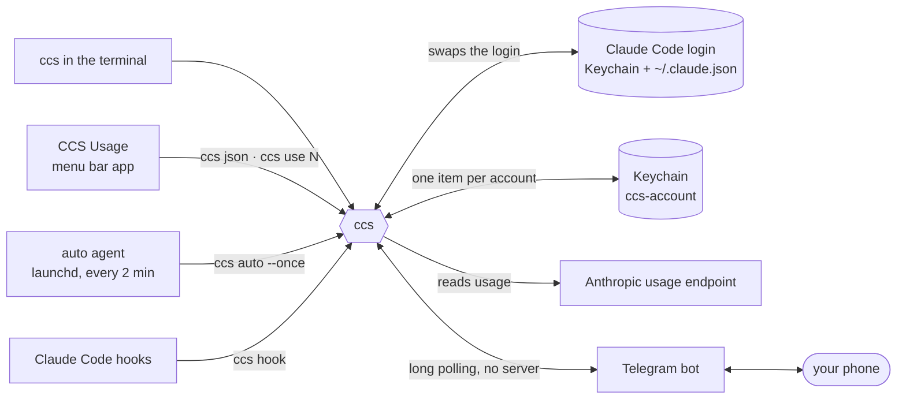
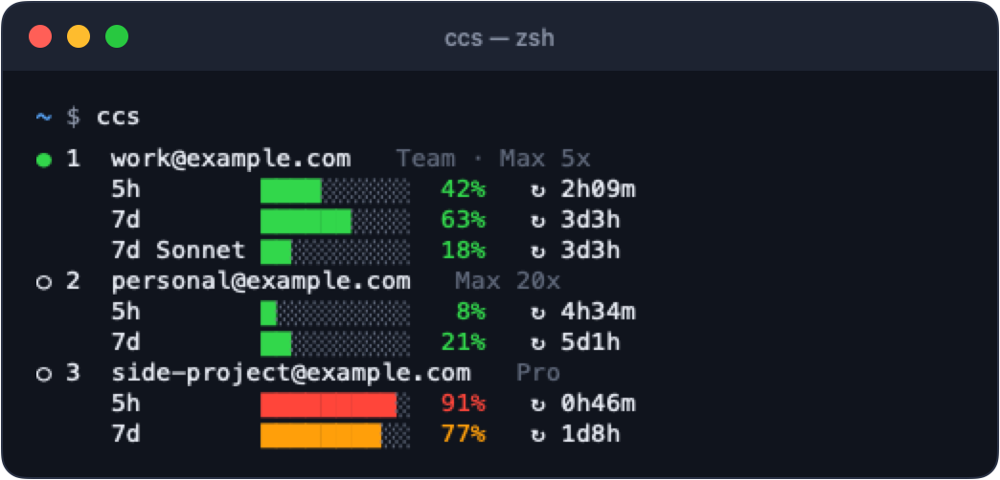
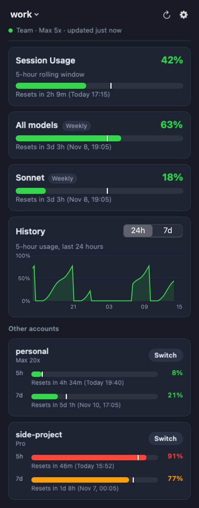
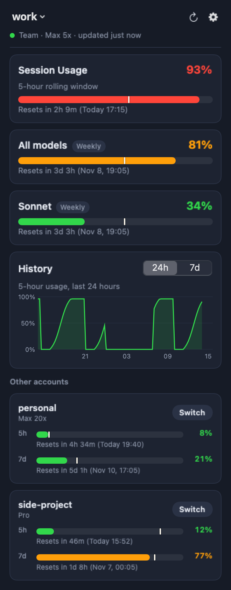

<p align="center">
  
</p>

<h1 align="center">ccs: Claude Code account switcher for macOS</h1>

<p align="center">
  <b>All your Claude Code accounts on one Mac.</b><br>
  See every 5-hour and weekly limit, switch in one click, and let it switch for you before a limit stops your work.
</p>

<p align="center">
  
  
  
  <a href="LICENSE"></a>
</p>

<p align="center">
  <a href="https://green-thunder.github.io/ccs/">Website</a> ·
  <a href="#install">Install</a> ·
  <a href="#commands">Commands</a> ·
  <a href="#menu-bar-app">Menu bar</a> ·
  <a href="#auto-switching">Auto-switch</a> ·
  <a href="#telegram">Telegram</a> ·
  <a href="#troubleshooting">Troubleshooting</a>
</p>

---

Claude Code is signed in to one account at a time. If you have a team seat and a personal plan, that means `/login` round trips, and you only find out an account is spent when it stops you mid-task. **ccs** keeps every login in the macOS Keychain, reads each account's usage, and swaps the active login in a second.

## At a glance

| | |
|---|---|
| 🖥 **Terminal** | `ccs` lists every account with its limits; `ccs use 2` switches. |
| 📊 **Menu bar** | The active account's `42% · 63%` at all times. Click for usage cards with pace markers, a 24-hour history chart and a **Switch** button per account. |
| ⚡ **Auto-switch** | Checks every 2 minutes. At 90% it asks, at 95% it moves you to the least-used account. |
| 📱 **Telegram** | Usage and switching from your phone. While you're away from the Mac, Claude's permission prompts and questions come to the phone with buttons. |
| 🔔 **Alerts** | A report with screenshots and files when a task finishes, a forecast before a limit runs out, and a warning when usage rises while nothing on your Mac is using Claude. |
| 🔒 **Careful with secrets** | Tokens live only in the Keychain. `.env` files, keys and the folders you list never leave the Mac. |
| 🪶 **Small** | One Python file with no dependencies, one SwiftUI file, and tests that never touch your real login. |

## How it works



`ccs` is the only program that touches the Claude Code login. The menu bar app, the auto agent, the hooks and the bot all go through it.

## Install

You need macOS 14 or later, the Claude Code CLI (`claude`), the Xcode command line tools (`swiftc`, for the menu bar app), and `/usr/local/bin/python3` (python.org Python 3.9+). Run these commands from this folder.

1. Install the script:
```bash
mkdir -p ~/.local/bin && cp ccs ~/.local/bin/ccs && chmod +x ~/.local/bin/ccs
```

2. Build the menu bar app (into `~/Applications/CCS Usage.app`):
```bash
menubar/build.sh
```

3. Start it now and at every login:
```bash
sed "s|__HOME__|$HOME|g" uz.ccs.menubar.plist > ~/Library/LaunchAgents/uz.ccs.menubar.plist && launchctl bootstrap gui/$(id -u) ~/Library/LaunchAgents/uz.ccs.menubar.plist
```

4. Turn on the auto agent:
```bash
sed "s|__HOME__|$HOME|g" uz.ccs.auto.plist > ~/Library/LaunchAgents/uz.ccs.auto.plist && launchctl bootstrap gui/$(id -u) ~/Library/LaunchAgents/uz.ccs.auto.plist
```

5. Start the Telegram bot (it waits quietly until you connect it, see [Telegram](#telegram)):
```bash
sed "s|__HOME__|$HOME|g" uz.ccs.telegram.plist > ~/Library/LaunchAgents/uz.ccs.telegram.plist && launchctl bootstrap gui/$(id -u) ~/Library/LaunchAgents/uz.ccs.telegram.plist
```

> launchd doesn't expand `~`, so the `.plist` files say `__HOME__` and the `sed` in each command fills in your home folder.

## Adding an account

1. Run `ccs` to save the current account.
2. In `claude`, run `/login` and sign in with the other account.
3. Run `ccs` again to add the new account to the list.

**Important:** always run `ccs` before `/login`. Claude Code renews its tokens from time to time, and if `ccs` holds an outdated copy, you'll have to log in to that account again. The agent also saves the current account every 2 minutes.

## Commands

| Command | What it does |
|---|---|
| `ccs` | lists accounts with 5h / 7d usage and time until each resets (`●` = active account) |
| `ccs use 2` or `ccs use gmail` | switches to account 2 (or the account whose email contains "gmail") |
| `ccs rm 2` | removes an account from the list and the Keychain (won't remove the active one) |
| `ccs auto --once` | checks once (this is what the agent runs) |
| `ccs auto` | keeps checking (in a terminal) |
| `ccs json` | accounts and usage as JSON (what the menu bar app reads) |
| `ccs tg setup` / `ccs tg` | connect the Telegram bot / run it (the LaunchAgent does this) |
| `ccs hook` | the Claude Code hook behind the phone alerts |

What `ccs` looks like (`●` = active account, `↻` = time until that limit resets):



The colors are the same everywhere: green below 70%, orange from 70%, red from 90%.

## Auto-switching

| Active account usage (5h or 7d) | What happens |
|---|---|
| under 90% | nothing |
| 90–95% | a dialog with **Switch** / **Not now** buttons appears |
| — you click **Switch** | switches right away and shows a notification |
| — no answer (closes after 100 s) | stays, and asks again at the next check |
| — you click **Not now** | doesn't ask again until that 5h window resets |
| 95% or more | switches without asking |

It only switches to an account that is **under** 90%, and picks the least-used one. If no account qualifies, it stays and writes that to the log.

**Changing the thresholds:** add the options to `ProgramArguments` in `~/Library/LaunchAgents/uz.ccs.auto.plist`, for example `<string>--ask</string><string>85</string>`. Then reload the agent:
```bash
launchctl bootout gui/$(id -u)/uz.ccs.auto; launchctl bootstrap gui/$(id -u) ~/Library/LaunchAgents/uz.ccs.auto.plist
```

To follow the log:
```bash
tail -f ~/.claude-accounts.log
```

## Menu bar app

**CCS Usage** is a small native app (SwiftUI) whose look follows [Claude-Usage-Tracker](https://github.com/hamed-elfayome/Claude-Usage-Tracker) (MIT). Its data and its switching come from `ccs` (`ccs json`, `ccs use N`), so `ccs` stays the only program that touches the Claude Code login.

<table>
  <tr>
    <td align="center" width="50%"></td>
    <td align="center" width="50%"></td>
  </tr>
  <tr>
    <td align="center">A normal day</td>
    <td align="center">Near a limit: at 95% auto-switch moves you on</td>
  </tr>
</table>

- **Menu bar:** a gauge and the active account's 5h · 7d usage, e.g. `5% · 24%`.
- **Popover header:** the active account's name. Tap it for a menu of all accounts, and pick one to switch. ⟳ refreshes. ⚙ has **Devices & sessions on claude.ai…**, which opens Settings → Account, where claude.ai lists every device signed in to the account and lets you sign one out (there's no API for this, so the app can't show it itself); **Claude Code tokens on claude.ai…**, which opens Settings → Claude Code, where users report that Claude Code logins and `claude setup-token` tokens (valid for a year) are listed and can be revoked one by one; and **Quit**. Careful there: the logins `ccs` saved for your accounts are Claude Code logins too, so revoking those means `/login` again for that account.
- **Cards:** one per limit of the active account: **Session Usage** (5-hour rolling window), **All models** (weekly), and the weekly Sonnet/Opus limits when the account has them. Each card shows:
  - the percentage, green below 70%, orange from 70%, red from 90%
  - a progress bar with a white **pace marker**: how much of that window's time has passed. A bar past the marker means you're using the limit faster than time goes by.
  - "Resets in 4h 18m (Today 20:29)"
- **History:** a chart of the active account's usage. **24h** shows the 5-hour usage over the last day: each sawtooth is a 5h window filling up and resetting. **7d** shows the weekly usage over the last week. It comes from `~/.claude-accounts-history.jsonl`, where every fresh usage reading is logged (about every 2 minutes per account, last 8 days kept), so it fills in over the first day.
- **Other accounts:** a card for each, with small 5h and 7d bars, their reset times and a **Switch** button.
- **Refreshing:** the data refreshes every minute, and the usage numbers themselves are cached for 2 minutes.

**Changing the look:** edit `menubar/CCSUsage.swift`, then run `menubar/build.sh` and restart the app:
```bash
launchctl kickstart -k gui/$(id -u)/uz.ccs.menubar
```

To check the look without opening the menu bar, draw the popover with live data into a PNG:
```bash
"$HOME/Applications/CCS Usage.app/Contents/MacOS/CCSUsage" --snapshot ~/Desktop/popover.png
```
Add `--data some.json` (a saved or edited `ccs json` output) to draw it with other numbers, e.g. to see how 95% or a full week of history looks. The screenshots in this README were made that way, with made-up accounts.

## Telegram

The bot runs on your Mac and polls Telegram, so it needs no server and no open port.

**Connect it once:**

1. In Telegram, open [@BotFather](https://t.me/BotFather), send `/newbot`, pick a name, and copy the token it gives you.
2. In a terminal on the Mac, run the setup and paste the token (the input stays hidden):
```bash
ccs tg setup
```
3. Open the link it prints on your phone and press **Start**. The link works once, and only that chat can use the bot afterwards. Messages from anyone else are ignored and logged.

**On your phone:**

| You send / press | What happens |
|---|---|
| any message, `/status` | usage of every account, with a **Switch to …** button per account |
| **Switch to …** | switches, then updates the same message |
| `/use 2` or `/use gmail` | switches to that account |
| **↻ Refresh** | updates the numbers |
| `/sessions` or **🖥 Sessions** | every Claude Code session active in the last 2 hours (see below) |
| **📎 project (n)** | the files Claude wrote in that session, each with a send button |
| any message not starting with `/` | goes to Claude as a chat (see [Chat with Claude](#chat-with-claude)) |
| `/new` | starts a new chat (the old one stays in `/chats`; model and effort stay) |
| `/chats` | your last 10 chats: tap one to continue it, 🗑 to delete it |
| `/clear` | deletes the current chat, after a confirmation |
| `/model`, `/model sonnet` | the chat's model: buttons, or set it directly |
| `/effort`, `/effort high` | the chat's effort: buttons, or set it directly |

At 90% the phone gets the same question as the Mac dialog, **Switch** / **Not now**, once per 5h window. Whichever you answer first counts. Without an answer it still switches by itself at 95%. Every automatic switch is also reported to the phone.

**Notes:**

- The Mac must be awake and online. Answers sent while it sleeps are handled when it wakes.
- To connect another bot or phone, run `ccs tg setup` again; the old pairing is replaced.

## Chat with Claude

Any message you send the bot that doesn't start with `/` goes to Claude. It's one ongoing conversation that remembers everything until you send `/new`.

- While Claude works, the chat shows "typing…". Messages sent meanwhile wait in line and are answered in order.
- Answers use Telegram formatting. Long answers come as several messages.
- **It's chat only.** Claude can search the web, but it has no tool that touches the Mac: no shell, no file access. It also doesn't load your settings, plugins, hooks or MCP servers. So anyone who got into your Telegram account could only chat; they couldn't reach your files.
- It uses the active account, so it counts toward that account's usage.

**Old chats:** `/chats` lists your last 10 chats, newest first. Each one is named by its first message and shows when it was last used; ▶ marks the current chat. Tap one to continue it: the bot shows Claude's last answer in that chat as a reminder, and your next message carries on from there. The list comes from Claude Code's own transcripts of the chat folder (the `~/.claude/projects/` folder named after `~/.ccs-chat`), so only phone chats can be opened or deleted this way, never sessions from your other projects.

**Deleting chats:** `/clear` deletes the chat you're in, and 🗑 next to a chat in `/chats` deletes that one. Both ask first ("Delete the chat “…”? This can't be undone." with **🗑 Delete** / **Cancel**), because deleting removes the transcript for good. Cancel takes you back to the list. After deleting the current chat, your next message starts a new one.

**Model and effort:** `/model` and `/effort` show buttons, with ✓ on the current choice. You can also set them directly, e.g. `/model sonnet` or `/effort low`.

- **Models:** `fable`, `opus`, `sonnet`, `haiku` (each means the latest of that family), or a full model name such as `claude-sonnet-5-5`.
- **Efforts:** `low`, `medium`, `high`, `xhigh`, `max`.
- **`default`** goes back to the account's default.
- A change applies from your next message, and the conversation continues where it was. `/new` and `/clear` keep your choice.

Under the hood each message runs:
```
claude -p --output-format json --restricted --tools WebSearch,WebFetch --strict-mcp-config \
       --resume <session> --model <model> --effort <effort>
```
from the empty folder `~/.ccs-chat`, with the message on stdin. The session id, model and effort are kept in `~/.ccs-chat/state.json`; `/new` removes only the session id.

## Phone alerts when Claude finishes or waits

`ccs hook` runs as a Claude Code hook and sends the paired phone:

- **✅ project · finished in 9m**, with the session title, Claude's last reply in a collapsed quote (tap to expand), 📎 buttons for files it wrote, the task's screenshots, and the documents it produced (see [Files to the phone](#files-to-the-phone))
- **⏳ project · waiting for you**, with the session title and the reason, e.g. "Claude needs your permission to use Bash"

**When:**

- **Finished report:** sent when the task took **60 seconds or more**, or when you're away from the Mac (no keyboard or mouse input for 60 seconds). Only quick replies while you're at the Mac stay quiet, since you're watching those anyway.
- **Waiting:** permission prompts and other things that block the task are always forwarded. The "Claude is waiting for your input" reminder that Claude Code sends a minute after every reply is not, because the report already said the task is done.

Claude's markdown is converted to Telegram formatting: bold, `code`, code blocks, headings, bullet lists and links. Tables become bullet lines (`• first column · other columns`), which fit a phone screen better than columns. Long replies are cut at a line break around 2,800 characters. If Telegram ever rejects the formatting, the alert is sent again as plain text.

The hook runs in the background (`"async": true`), so it never slows Claude down.

It's set up in `~/.claude/settings.json`. All entries run the same command; the last three also feed `/sessions` and the 📎 buttons:
```json
"hooks": {
  "Stop":             [{ "hooks": [{ "type": "command", "command": "/usr/local/bin/python3 $HOME/.local/bin/ccs hook", "async": true }] }],
  "Notification":     [{ "hooks": [{ "type": "command", "command": "/usr/local/bin/python3 $HOME/.local/bin/ccs hook", "async": true }] }],
  "UserPromptSubmit": [{ "hooks": [{ "type": "command", "command": "/usr/local/bin/python3 $HOME/.local/bin/ccs hook", "async": true }] }],
  "PostToolUse":      [{ "matcher": "Write|Edit|NotebookEdit",
                         "hooks": [{ "type": "command", "command": "/usr/local/bin/python3 $HOME/.local/bin/ccs hook", "async": true }] }],
  "SessionEnd":       [{ "hooks": [{ "type": "command", "command": "/usr/local/bin/python3 $HOME/.local/bin/ccs hook" }] }],
  "PreToolUse":       [{ "matcher": "AskUserQuestion",
                         "hooks": [{ "type": "command", "command": "/usr/local/bin/python3 $HOME/.local/bin/ccs hook", "timeout": 1800 }] }]
}
```

The `PreToolUse` entry is what asks Claude's questions on the phone. It isn't async because it has to wait for your answer, and it returns immediately while you're at the Mac.

To turn phone alerts off, remove the `Stop` and `Notification` entries. Sessions that are already running pick up changes only after a restart.

## Heads-ups on the phone

- **☀️ Morning summary:** once a day, the first time the bot runs between 9:00 and 12:00, you get every account's usage (the `/status` view). If the Mac is asleep at 9, it comes when it wakes, but never after 12.
- **⏱ Forecast:** when the account in use is on track to hit a limit before it resets, you get "at this pace the 5h limit runs out around 14:20, 1h 10m before it resets (15:30)". The pace comes from the history: the last hour for the 5h limit, the last 12 hours for the weekly one. It's sent only when the limit would run out within the next hour (5h) or day (weekly), once per limit window. It also says what auto-switch will do: "moves you to other@example.com at 95%" if another account is under 90%, otherwise "no other account has room, so auto-switch won't move you".
- **✅ Free again:** when a limit you'd used to 80% or more resets, on any account: "other@example.com · the 5h limit reset (was 95%): it's free again."

## Permission requests on the phone

When Claude asks for permission (to run a command, edit a file…) while you're away from the Mac (no keyboard or mouse input for 60 seconds), the request comes to the phone with the full command (for other tools, their whole input: a file write shows the content, an edit shows the change) and **✅ Allow** / **⛔ Deny** buttons. Your tap goes back to Claude Code as your answer. **Deny** tells Claude "Denied from the phone".

- **At the Mac, in a `~/.ccs-no-send` folder, or too long to show in full on the phone (over 3,500 characters):** asked on the Mac as usual. The phone still gets the "waiting for you" heads-up.
- **Back at the Mac first, or no answer within 25 minutes:** the request moves to the Mac; the phone message says so.
- **Read the command before you tap Allow:** it runs with that session's full rights.

It's the `PermissionRequest` hook in `~/.claude/settings.json` (no matcher, so it covers every tool; not async, timeout 1800 seconds):
```json
"PermissionRequest": [{ "hooks": [{ "type": "command", "command": "/usr/local/bin/python3 $HOME/.local/bin/ccs hook", "timeout": 1800 }] }]
```

## Usage you didn't cause

Every time `ccs` fetches fresh usage (the menu bar app does this every minute), it compares each account's 5h usage with the previous reading. If usage rose by **2 points or more** and nothing on this Mac explains it, the phone gets a warning:

```
⚠️ other@example.com · 5h usage rose 12% → 18% between 09:40 and 09:52,
while nothing on this Mac was using Claude.
[Claude Code tokens] [Devices & sessions]
```

- **What counts as "this Mac using Claude":** any Claude Code session here (terminal or desktop app), and the phone chat.
- **For the account in use:** it warns only when no session here was active since the previous reading.
- **For any other account:** nothing here could have used it, so it warns even while you're working, unless you switched away from it in the meantime.
- **New 5h window:** usage counts from zero.
- **At most one warning per account per hour.**

Your own claude.ai chats (web, phone) and other computers of yours use the same limits, so they trigger it too. The warning means "check", not "you've been hacked". The buttons open the two claude.ai pages where you can see and revoke what's signed in.

## Screenshots and questions on the phone

- **Screenshots:** images Claude got from its tools during the task (browser, simulator and design screenshots, previews) come with the "finished" report and with each question, at most the last 4, each only once. A screenshot Telegram won't take as a photo (too big, odd proportions) comes as a file.
- **Questions while you're away** (no keyboard or mouse input for 60 seconds): when Claude asks with its question tool (`AskUserQuestion`), each question comes as a message with a button per option. For multi-select, tick the options and tap **✅ Done**. To answer something else, reply to the question message with your own text. When all questions are answered, Claude gets the answers as yours and carries on.
- **Back at the Mac first?** Touch the keyboard or mouse and the question moves to the Mac within a second; the phone message changes to "this question is on the Mac now". The same happens if nobody answers within 25 minutes.
- **Questions while you're at the Mac** show there as usual. The phone gets a heads-up, "Claude asks: … Answer it at the Mac", in case that session is in a window you're not looking at.
- **Folders in `~/.ccs-no-send`**: no screenshots, no reply text and no questions leave the Mac. You only get "finished" or "Claude asks a question, answer it at the Mac".

Questions Claude asks in plain text at the end of its reply arrive with the "finished" alert, but can only be answered at the Mac.

## Sessions on the phone

`/sessions` lists every Claude Code session active in the last 2 hours, newest first:

```
shop · ⚙️ working · 2m ago
Fix the checkout bug
Opus 5.5 · effort high · context left 72%
📎 3 file(s) written
```

- **State:** ⚙️ working, ⏳ needs you (with the reason), or 💤 idle. It comes from the hooks: `UserPromptSubmit`, `Notification`, `Stop`, and `SessionEnd` (ended sessions are hidden).
- **Model, effort, context:** these come from the status line, which saves them to `~/.claude-sessions/<session id>.json` each time it updates.
- **Files:** a `PostToolUse` hook on `Write|Edit|NotebookEdit` records every file Claude writes, in `~/.claude-sessions/<session id>.log`.
- Records older than a week are deleted automatically.

## Files to the phone

**Documents a task produced come with its report automatically**: PDF, Word, Excel, PowerPoint, OpenDocument, CSV, ZIP, EPUB, and image files such as charts (images as photos). This covers files made by a script (`python make_report.py`, pandoc, a headless browser…), not just ones written with Claude's file tool. A file counts when it changed during that task, and it is either:

- **inside the project**, skipping hidden folders and `node_modules`, `dist`, `build`, `target`, `coverage`, `venv`, `__pycache__`. Not when Claude works in your home folder or straight in `~/Desktop`, `~/Downloads`, `~/Documents` and the like, because other apps save files there too; or
- **anywhere Claude names it in its reply**, e.g. `~/Desktop/report.pdf`.

Up to 5 come with the report, documents before image files; the rest are listed under `/sessions`.

Other files Claude wrote with its file tool (code, markdown…) get a 📎 button instead: the report has one per file written during that task, up to 6, and `/sessions` → **📎 project** lists the last 10 files of a session. Tap a button and the bot sends that file.

**Safety rules**, checked again at every tap:

- Only files Claude itself wrote in that session can be sent; a button can't point to any other path.
- Only documents a task produced (above) are sent on their own; every other file needs a tap.
- **Never sent:** `.env` files, keys and certificates (`.pem`, `.key`, `.p12`, `id_rsa`…), database dumps (`.sql`, `.dump`, `.db`, `.sqlite`), and anything whose name contains secret, credential or password.
- **Blocked folders:** nothing inside a folder listed in `~/.ccs-no-send`, including symlinks that point there. Sessions working in those folders also send no reply text, screenshots or questions (see above). Put any folder with sensitive data there, such as client or patient records:
  ```
  # one folder per line, subfolders included
  /Users/you/work/client-records
  ```
- Empty files and files over 50 MB (Telegram's limit) are skipped.
- A refused file shows the reason in a pop-up. Blocked files appear in the list with 🚫 and the reason, but without a button.

Keep in mind that a file sent to a Telegram bot is stored on Telegram's servers and isn't end-to-end encrypted.

## Status line

`~/.claude/statusline-command.sh` shows the active account right after the model name, for example:
```
Opus 5.5 @you | effort:high ctx:72% 5h:8% 7d:83% 15:22:46
```
The script also saves each session's model, effort and context for `/sessions` (the block starting with `# Save this session's model`).

It reads `oauthAccount.emailAddress` from `~/.claude.json`, which `ccs use` and `/login` both update. These two lines in the script do it:
```sh
account=$(jq -r '.oauthAccount.emailAddress // empty | split("@")[0]' ~/.claude.json 2>/dev/null)
line="$line $(printf '\033[36m@%s\033[0m' "$account")"
```

## Files and data

| File | Purpose | Installed to |
|---|---|---|
| `ccs` | main script (Python, standard library only) | `~/.local/bin/ccs` |
| `menubar/` | the menu bar app (SwiftUI): `CCSUsage.swift`, `Info.plist`, `build.sh` | `~/Applications/CCS Usage.app` |
| `uz.ccs.auto.plist` | auto-switch agent | `~/Library/LaunchAgents/` |
| `uz.ccs.telegram.plist` | Telegram bot (always running) | `~/Library/LaunchAgents/` |
| `uz.ccs.menubar.plist` | starts the menu bar app at login | `~/Library/LaunchAgents/` |
| `test_ccs.py` | test (never touches your real login) | — |
| `docs/` | the screenshots and the website ([GitHub Pages](https://green-thunder.github.io/ccs/)) | — |

`ccs` keeps its data in these places:

- **Tokens:** the macOS Keychain, in items named `ccs-account` (never in a plain file); the Telegram bot token is in `ccs-telegram`
- **Account list:** `~/.claude-accounts.json`
- **Usage cache and "Not now" answers:** `~/.claude-accounts-usage.json`
- **Usage history** (chart and forecasts): `~/.claude-accounts-history.jsonl`
- **Auto log:** `~/.claude-accounts.log`

## After changing the code

```bash
python3 test_ccs.py && cp ccs ~/.local/bin/ccs
```

## Troubleshooting

| What you see | Cause and fix |
|---|---|
| `rate limited, retry in …s` / `HTTP 429` | The usage API allows only a few requests per minute. `ccs` waits and shows the last known numbers meanwhile. It clears by itself. |
| An expired token | Nothing to do. When no `claude` has run for a while, the active account's token expires; `ccs` renews it and hands the new one to Claude Code. It writes it only if Claude Code didn't renew it at the same moment, so the two never overwrite each other. The auto agent keeps it fresh every 2 minutes. |
| `HTTP 400/401, log in to this account again` | The saved login is no longer valid. Sign in to that account with `/login` in `claude`, then run `ccs`. |
| A running session stays on the old account | Exit the session and continue it with `claude -c`. |
| Nothing in the menu bar | Start the app with `launchctl kickstart gui/$(id -u)/uz.ccs.menubar`. If it's missing after every restart, install `uz.ccs.menubar.plist` (install step 3). If the menu bar is full, macOS hides items that don't fit: close some other menu bar apps. |
| The popover says "ccs json failed" | Run `ccs json` in a terminal to see the error, e.g. no accounts saved yet. |
| The bot doesn't answer | Check the Mac is awake, then `tail ~/.claude-accounts.log` for `telegram:` lines. If you started another copy of `ccs tg`, stop it: Telegram allows only one. |

## Uninstall

1. Stop the agents and delete their files:
```bash
launchctl bootout gui/$(id -u)/uz.ccs.auto && rm ~/Library/LaunchAgents/uz.ccs.auto.plist
```
```bash
launchctl bootout gui/$(id -u)/uz.ccs.telegram && rm ~/Library/LaunchAgents/uz.ccs.telegram.plist
```
```bash
launchctl bootout gui/$(id -u)/uz.ccs.menubar && rm ~/Library/LaunchAgents/uz.ccs.menubar.plist && rm -r "$HOME/Applications/CCS Usage.app"
```

2. Delete the script, the plugin and the data files:
```bash
rm ~/.local/bin/ccs ~/.claude-accounts.json ~/.claude-accounts-usage.json ~/.claude-accounts-history.jsonl ~/.claude-accounts.log
```

3. In the **Keychain Access** app, search for `ccs-account` and `ccs-telegram` and delete the items it finds. Claude Code's own login (`Claude Code-credentials`) stays in place.

## Limitations

- macOS only, and only for `claude` in the terminal (default config folder). The Code tab of the Claude desktop app uses its own login.
- Remote control works only while the Mac is awake and online.
- A switch between two real accounts with `ccs use` hasn't been checked end to end yet. The switch logic is covered by tests on throwaway accounts.
- Using several accounts to get around usage limits may break Anthropic's terms.
- `ccs` uses Claude Code's own login and an undocumented usage endpoint. Either can change without notice and break it.

## License

MIT, see [LICENSE](LICENSE). Not affiliated with or endorsed by Anthropic.
